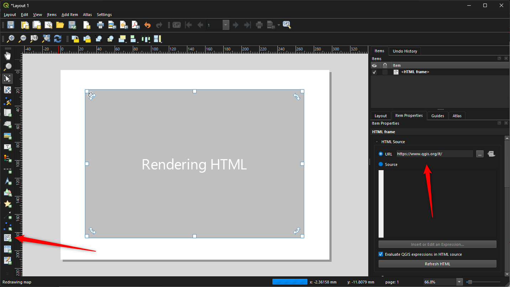
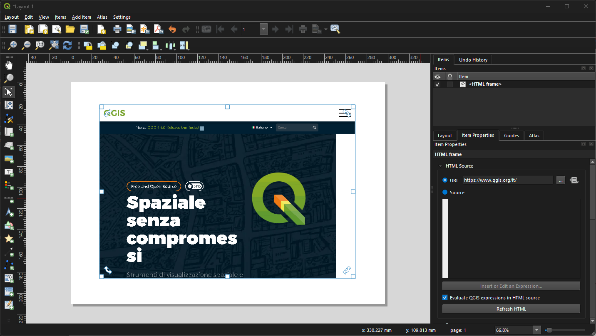
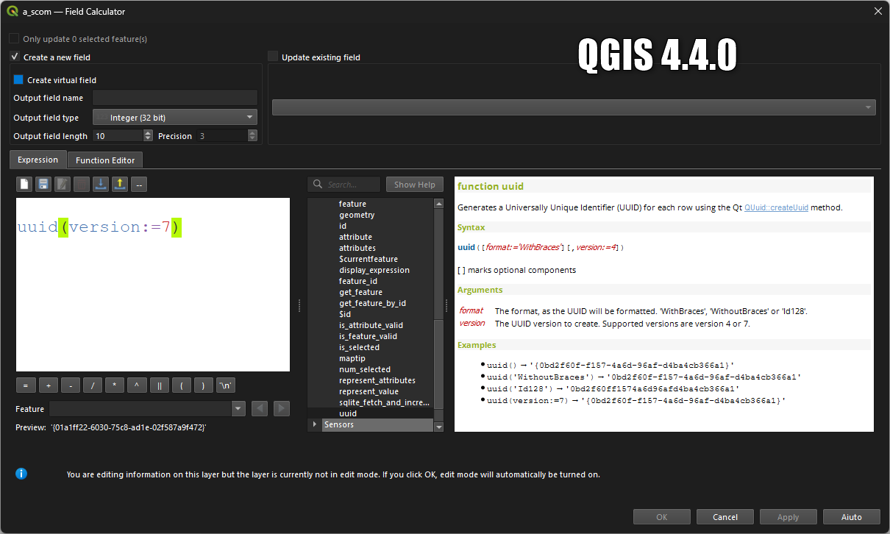
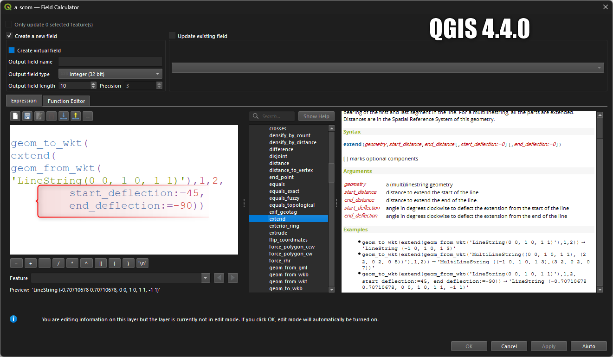
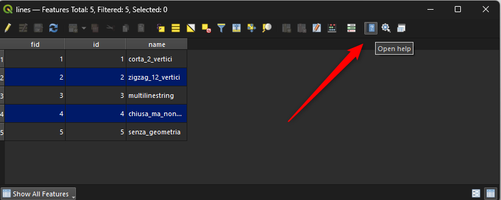

# QGIS 4.4: torna l'elemento HTML nel layout di stampa

## Introduzione

[QGIS 4.4 Auckland](https://changelog.qgis.org/en/qgis/version/4.4/), rilasciata il 20 novembre 2026, è la **candidata alla Long Term Release (LTR)**: dopo alcuni cicli di correzione diventerà la versione stabile di riferimento per il prossimo anno. Il changelog conta 48 feature in 18 categorie, e il grosso del lavoro si concentra su **Processing** e sulle correzioni:

| Categoria | Feature |
|---|--:|
| Processing | 11 |
| Notable Fixes | 9 |
| 3D Features | 4 |
| QGIS Server | 3 |
| Symbology, Annotations, Labelling, Rendering, Expressions, Data Management, Programmability | 2 ciascuna |
| Documentation, User Interface, Print Layouts, Digitising, Forms and Widgets, Application and Project Options, Profile Plots | 1 ciascuna |

Anche questa volta la firma più ricorrente è quella di Nyall Dawson (North Road), autore di 21 feature su 48.

La novità che però interessa di più a chi produce cartografia e report **non compare nel changelog**: con QGIS 4.4 torna a funzionare l'**elemento HTML nel layout di stampa**, che con il passaggio a Qt6 era rimasto di fatto inutilizzabile.

!!! Abstract "In breve"
    **Layout di stampa**: l'elemento HTML torna a essere renderizzato ed esportato, ora con il motore QtWebEngine al posto di QtWebKit ([PR #68161](https://github.com/qgis/QGIS/pull/68161)). **Espressioni**: nuovi argomenti per `uuid` (UUID v7) ed `extend` (angoli di deviazione). **Tabella attributi e moduli**: pulsante di aiuto e widget QML modificabile. Inoltre DB Manager lascia definitivamente il core e diversi strumenti idrologici di SAGA diventano algoritmi nativi.

<!-- more -->

## L'elemento HTML nel layout di stampa

### Perché era sparito

L'elemento HTML del layout (*Aggiungi HTML*) permette di inserire in una tavola contenuti HTML/CSS: tabelle formattate, testi impaginati, pagine web esterne. È molto usato nei report e negli **atlanti**, perché con l'opzione *Valuta espressioni QGIS nel sorgente HTML* il contenuto cambia per ogni feature.

Fino alla serie 3.x il rendering era affidato a **QtWebKit**. Con QGIS 4.0 il core è passato a **Qt6**, dove QtWebKit non esiste più: le build di QGIS 4.0 e 4.2 erano quindi compilate senza WebKit, e l'elemento HTML non veniva più disegnato. All'esportazione QGIS lo segnalava chiaramente:

> *HTML items cannot be rendered because this QGIS install was built without WebKit support. These items will be missing from the export.*

In pratica, chi apriva in QGIS 4.0/4.2 un progetto con layout basati su cornici HTML si ritrovava tavole e PDF con dei buchi.

### Cosa cambia in QGIS 4.4

Con la [PR #68161](https://github.com/qgis/QGIS/pull/68161) *Restore layout HTML item functionality* (Nyall Dawson, entrata nella 4.4.0 proprio il giorno del rilascio) l'elemento HTML torna a funzionare, questa volta usando **QtWebEngine**, il motore basato su Chromium:

- il contenuto HTML viene convertito in PDF da una piccola utility a riga di comando, `qgis_html_to_pdf` ([PR #66787](https://github.com/qgis/QGIS/pull/66787)), che usa WebEngine;
- il PDF viene poi disegnato nel layout come **grafica vettoriale** tramite la libreria **PDF4Qt**;
- il rendering avviene **in background**, come già succede per mappe, legende e profili altimetrici: nel designer si vede un'anteprima che si aggiorna mentre si lavora, senza bloccare l'interfaccia durante zoom e spostamenti.

Nel layout l'elemento si aggiunge con il pulsante **Add HTML** della barra strumenti a sinistra. Nelle proprietà, in *HTML Source*, si sceglie se caricare una pagina da **URL** (nell'esempio <https://www.qgis.org/it/>) oppure scrivere il codice nel campo **Source**. Mentre il contenuto viene elaborato in background, il riquadro mostra la scritta *Rendering HTML*:

[](./layout_html_item.png)

Dopo pochi istanti la pagina compare nel layout, disegnata come un qualsiasi altro elemento della tavola:

[](./layout_html_item_render.png)

Il giro è un po' tortuoso, e lo stesso autore lo ammette nella PR ("*Kind of, sort of. At least it's a start*"). Il motivo è tecnico: WebEngine può lavorare solo nel thread principale dell'interfaccia, mentre il rendering dei layout deve poter avvenire in un thread separato.

!!! warning "Da sapere"
    - **Testo convertito in curve**: nei PDF esportati il testo dell'elemento HTML non è selezionabile, perché viene esportato come tracciati vettoriali. Per la stampa non cambia nulla, ma non si può copiare né cercare.
    - **Dipende dalla build**: la funzione richiede un QGIS compilato con **WebEngine** e **PDF4Qt**. Se mancano, all'esportazione QGIS mostra lo stesso avviso di prima e l'elemento resta vuoto.
    - Le **dimensioni** possono essere leggermente diverse rispetto a QGIS 3.x: il vecchio motore WebKit scalava il contenuto in modo non corretto ([#19901](https://github.com/qgis/QGIS/issues/19901)). Conviene ricontrollare i layout ereditati dalle versioni precedenti.

### Un esempio con le espressioni

L'uso più tipico dell'elemento HTML è in un atlante, con *Valuta espressioni QGIS nel sorgente HTML* attivo. Le espressioni vanno scritte tra `[%` e `%]` e vengono calcolate sulla feature corrente:

```html
<h2>[% "nome" %]</h2>
<table>
  <tr><td>Superficie</td><td>[% format_number($area / 10000, 2) %] ha</td></tr>
  <tr><td>Perimetro</td><td>[% format_number($perimeter, 0) %] m</td></tr>
  <tr><td>Codice</td><td>[% concat_ws(' - ', "codice", "sigla") %]</td></tr>
</table>
```

Dentro le espressioni si possono usare tutte le funzioni del calcolatore di campi documentate su questo sito, comprese quelle arrivate con QGIS 4.x come [`concat_ws`](../../../gr_funzioni/stringhe_di_testo/stringhe_di_testo_unico.md#concat_ws). E rispetto a QtWebKit, QtWebEngine supporta meglio i CSS moderni (flexbox, grid, font web).

## Le altre novità

### Espressioni

In QGIS 4.4 non arrivano nuove funzioni, ma due funzioni esistenti ricevono nuovi argomenti opzionali.

[`uuid`](../../../gr_funzioni/record_e_attributi/record_e_attributi_unico.md#uuid) accetta l'argomento `version`, con i valori `4` (predefinito) e `7` ([PR #66772](https://github.com/qgis/QGIS/pull/66772)). Gli UUID v7 iniziano con un timestamp e sono quindi **ordinabili cronologicamente**: sono più adatti come chiavi primarie nei database. Richiedono una build basata su Qt 6.9 o successiva.

```qgis
uuid(version:=7) → '{01a1ff22-6030-75c8-ad1e-02f587a9f472}'
```

[](./uuid.png)

[`extend`](../../../gr_funzioni/geometria/geometria_unico.md#extend) accetta `start_deflection` ed `end_deflection`, che deviano di un angolo (in gradi, in senso orario) il prolungamento iniziale e/o finale della linea ([PR #66714](https://github.com/qgis/QGIS/pull/66714)):

```qgis
geom_to_wkt(extend(geom_from_wkt('LineString(0 0, 1 0, 1 1)'),1,2, start_deflection:=45, end_deflection:=-90))
→ 'LineString (-0.70710678 0.70710678, 0 0, 1 0, 1 1, -1 1)'
```

[](./extend_deflection.png)

### Tabella attributi e moduli

- La barra strumenti della tabella attributi ha un nuovo pulsante **Open help** (icona **?**), che apre la pagina del manuale di QGIS dedicata alla tabella ([PR #67791](https://github.com/qgis/QGIS/pull/67791)).
- Il widget **QML** dei moduli, che finora poteva solo mostrare dei valori, ora può anche **modificare** gli attributi della feature ([PR #67963](https://github.com/qgis/QGIS/pull/67963)).

[](./tabella_attributi_help.png)

### DB Manager lascia il core

Si chiude la vicenda raccontata nel post [QGIS 4.2: DB Manager lascia il core (ma non subito)](../addio_db_manager/index.md): in QGIS 4.4 DB Manager è stato rimosso, come previsto dalla [QEP 426](https://github.com/qgis/QGIS-Enhancement-Proposals/blob/master/qep-426-demote_dbmanager.md). Al suo posto un messaggio invita a installare il plugin [DB Manager Community](https://plugins.qgis.org/plugins/db_manager_community), mantenuto nella repo [qgis/db_manager_plugin](https://github.com/qgis/db_manager_plugin).

### Processing: idrologia nativa

La categoria più ricca è Processing: diversi strumenti idrologici di SAGA sono stati portati ad algoritmi nativi di QGIS, grazie a una [campagna di crowdfunding](https://www.qwast-gis.com/l/native-hydrology-tools-in-qgis-4-4/) promossa da Hans van der Kwast. Tra questi: *Channel Network and Drainage Basins*, *D8 flow direction* con connettività e ordine di Strahler, *Upslope Area* e l'interpolazione *thin plate spline*. Si aggiungono il nuovo algoritmo per creare tile raster XYZ in GeoPackage, il formato WebP e l'opzione per saltare le tile vuote.

## Correzioni rilevanti

Tra i fix di questa versione, quelli che riguardano espressioni e tabella attributi:

- [`array_insert`](../../../gr_funzioni/array/array_unico.md#array_insert): corretta una scrittura fuori dai limiti dell'array ([PR #67888](https://github.com/qgis/QGIS/pull/67888))
- [`levenshtein`](../../../gr_funzioni/corrispondenza_fuzzy/corrispondenza_fuzzy_unico.md#levenshtein): corretta una lettura fuori dai limiti ([PR #68130](https://github.com/qgis/QGIS/pull/68130))
- una feature rifiutata dal database veniva considerata salvata e poi persa uscendo dalla modalità modifica ([#67474](https://github.com/qgis/QGIS/issues/67474), [PR #67792](https://github.com/qgis/QGIS/pull/67792))
- crash annullando l'eliminazione di un campo usato per l'ordinamento della tabella ([#68157](https://github.com/qgis/QGIS/issues/68157), [PR #68158](https://github.com/qgis/QGIS/pull/68158))
- filtro sui file CSV quando il nome della colonna contiene uno spazio ([#68189](https://github.com/qgis/QGIS/issues/68189), [PR #68194](https://github.com/qgis/QGIS/pull/68194))

L'elenco completo è nella pagina [Novità QGIS 4.4](../../../release/novita_440.md).

## Conclusioni

Per chi è rimasto su QGIS 3.x per via dei layout con elementi HTML, la 4.4 è la prima versione della serie 4 su cui vale la pena ricontrollare report e atlanti. La soluzione è ancora giovane (testo esportato come curve, dipendenza dalla build), ma è un primo passo concreto, e arriva proprio nella versione destinata a diventare LTR. Se provi i tuoi layout HTML con QGIS 4.4, raccontaci com'è andata.

## Discussioni

Per commenti o domande: <https://github.com/opendatasicilia/HfcQGIS-md/discussions>

## Link utili

- [Changelog QGIS 4.4](https://changelog.qgis.org/en/qgis/version/4.4/)
- [PR #68161 - Restore layout HTML item functionality](https://github.com/qgis/QGIS/pull/68161)
- [Manuale QGIS - elemento HTML del layout](https://docs.qgis.org/latest/it/docs/user_manual/print_composer/composer_items/composer_html_frame.html)
