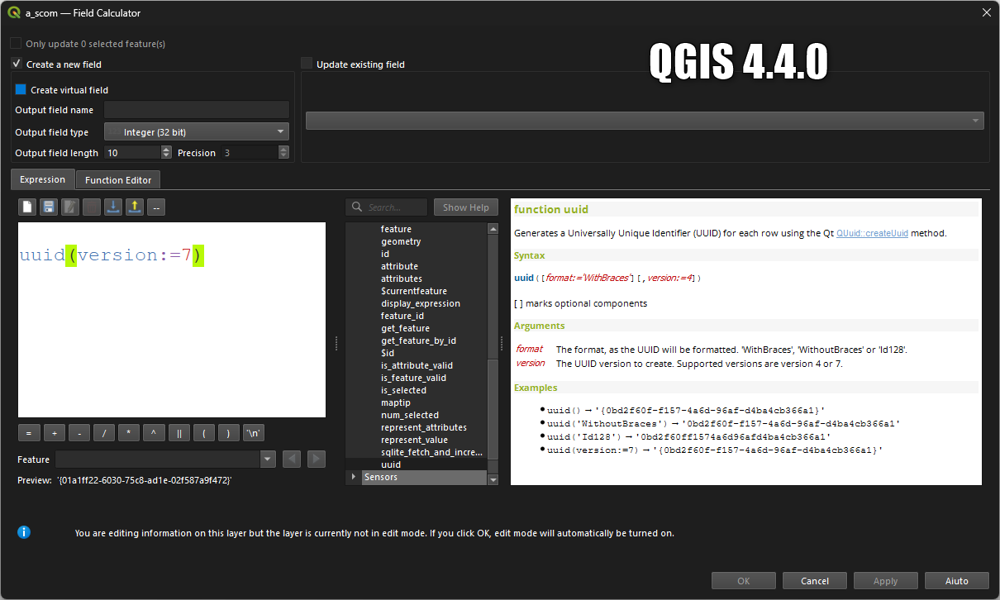
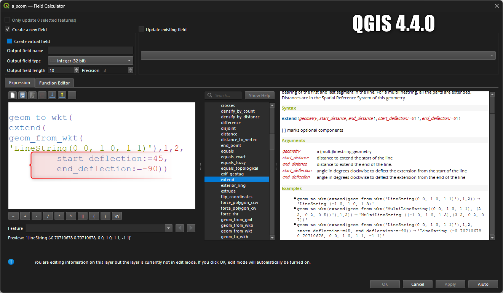
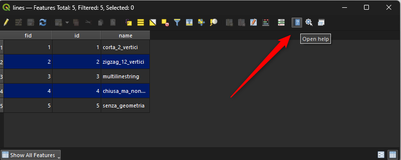

# Novità rilevanti introdotte in QGIS 4.4 Auckland

[QGIS 4.4](https://changelog.qgis.org/en/qgis/version/4.4/) - candidata alla Long Term Release (LTR)

## Espressioni

Nessuna nuova funzione: in QGIS 4.4 due funzioni esistenti ricevono nuovi argomenti opzionali.

### Gruppo Record e attributi

- aggiornata la funzione [`uuid`](../gr_funzioni/record_e_attributi/record_e_attributi_unico.md#uuid): nuovo argomento opzionale `version` per scegliere la versione dell'UUID da generare; i valori ammessi sono `4` (predefinito) e `7` ([PR #66772](https://github.com/qgis/QGIS/pull/66772))

```
uuid(version:=7) → '{01a1ff22-6030-75c8-ad1e-02f587a9f472}'
```

!!! tip "Perché UUID v7?"
    Gli UUID versione 7 iniziano con un timestamp: sono quindi **ordinabili cronologicamente**, a differenza dei v4 che sono completamente casuali. Sono utili come chiavi primarie nei database (es. GeoPackage, PostgreSQL), perché mantengono gli indici più compatti.

    La versione 7 richiede una build di QGIS basata su Qt 6.9 o successiva, altrimenti la funzione restituisce un errore.



### Gruppo Geometria

- aggiornata la funzione [`extend`](../gr_funzioni/geometria/geometria_unico.md#extend): nuovi argomenti opzionali `start_deflection` e `end_deflection` che deviano l'estensione iniziale e/o finale della linea di un angolo espresso in gradi, in senso orario (predefinito `0`) ([PR #66714](https://github.com/qgis/QGIS/pull/66714))

```
extend(geometry, start_distance, end_distance [, start_deflection=0] [, end_deflection=0])

geom_to_wkt(extend(geom_from_wkt('LineString(0 0, 1 0, 1 1)'),1,2, start_deflection:=45, end_deflection:=-90))
→ 'LineString (-0.70710678 0.70710678, 0 0, 1 0, 1 1, -1 1)'
```



## Tabella attributi

### Feature: Add a Help button to the attribute table

- nella barra strumenti della tabella attributi c'è ora il pulsante **Open help** (icona ?) che apre la pagina corrispondente del manuale di QGIS ([PR #67791](https://github.com/qgis/QGIS/pull/67791))



### Feature: Implement attribute form QML editor widget's editing capabilities

- il widget **QML** dei moduli di inserimento, che finora poteva solo mostrare valori calcolati da espressioni, ora può anche **modificare** gli attributi della feature e reagisce alle modifiche del record corrente e allo stato di modifica del modulo ([PR #67963](https://github.com/qgis/QGIS/pull/67963))

## Correzioni rilevanti (Notable Fixes)

Fix relativi a espressioni e tabella attributi:

- espressioni: gestione dei valori `QgsInterval` (intervalli) con il driver PostgreSQL ([#62577](https://github.com/qgis/QGIS/issues/62577), [PR #68066](https://github.com/qgis/QGIS/pull/68066))
- [`array_insert`](../gr_funzioni/array/array_unico.md#array_insert): corretta una scrittura fuori dai limiti dell'array ([PR #67888](https://github.com/qgis/QGIS/pull/67888))
- [`levenshtein`](../gr_funzioni/corrispondenza_fuzzy/corrispondenza_fuzzy_unico.md#levenshtein): corretta una lettura fuori dai limiti ([PR #68130](https://github.com/qgis/QGIS/pull/68130), backport su 3.44)
- fix crash aggiungendo una nuova feature dalla tabella attributi su un layer vuoto ([#65025](https://github.com/qgis/QGIS/issues/65025))
- fix: una feature rifiutata dal database veniva considerata salvata e poi persa uscendo dalla modalità modifica ([#67474](https://github.com/qgis/QGIS/issues/67474), [PR #67792](https://github.com/qgis/QGIS/pull/67792))
- fix crash annullando l'eliminazione di un campo usato per l'ordinamento della tabella ([#68157](https://github.com/qgis/QGIS/issues/68157), [PR #68158](https://github.com/qgis/QGIS/pull/68158))
- fix del filtro sui file di testo delimitato (CSV) quando il nome di colonna contiene uno spazio ([#68189](https://github.com/qgis/QGIS/issues/68189), [PR #68194](https://github.com/qgis/QGIS/pull/68194))
- fix del filtro sulle feature dei layer WFS, regressione di QGIS 4.2 ([#67715](https://github.com/qgis/QGIS/issues/67715), [PR #67813](https://github.com/qgis/QGIS/pull/67813))

---

Vedi anche: [changelog completo QGIS 4.4](https://changelog.qgis.org/en/qgis/version/4.4/)
